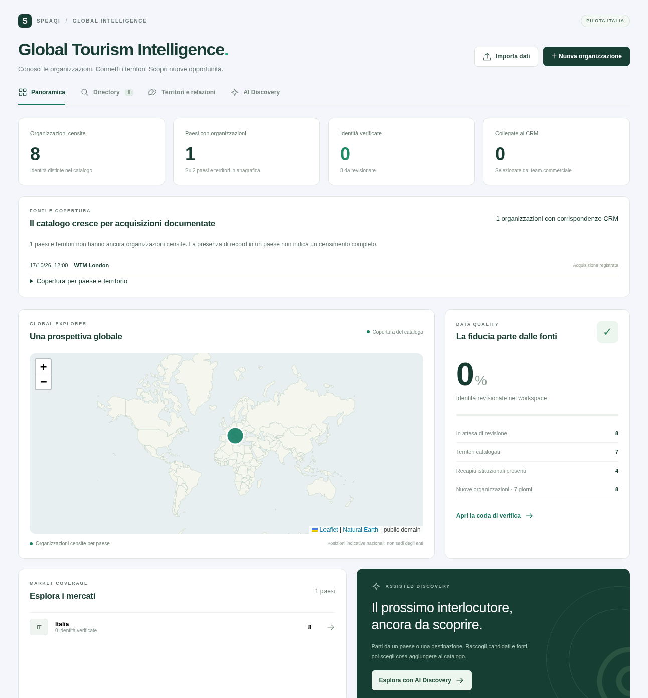

# Acquisizione mondiale e matching CRM — 17–18 ottobre 2026

Il catalogo sul Supabase del CRM è stato popolato con organizzazioni reali. I risultati verificati con query sul database sono in [acquisition-results.json](./acquisition-results.json). Le cinque organizzazioni inserite precedentemente dall'utente sono state confrontate con il backup e conservate, comprese le loro evidenze.

Risultato dopo l'integrazione TTG: **3.360 organizzazioni in 240 paesi e territori**, di cui 3.355 aggiunte durante le acquisizioni e 5 preesistenti. Sono presenti 250 riferimenti geografici di paese/territorio, 4.159 evidenze e 134 relazioni documentate. Il matching propone 93 coppie organizzazione/contatto per 59 organizzazioni. Il CRM conserva 62.164 contatti e nessun collegamento è stato confermato automaticamente.

Undici schede sono conservate per revisione dell'ambito ed escluse dal matching: il ruolo turistico diretto o DMC/incoming non è sufficientemente documentato. Le altre 3.349 sono nel perimetro della selezione e richiedono comunque verifica umana. Nessuna organizzazione è stata dichiarata verificata dal processo automatico.

## Integrazione TTG: enti turistici, DMC e OTA

Il confronto riguarda i **2.266 profili TTG 2026 già acquisiti nella tabella fiere del workspace**: primo import l'11 ottobre, ultime modifiche di workspace il 14 ottobre. Le date di modifica CRM non dimostrano un nuovo scaricamento del profilo pubblico. La directory live non è stata riconciliata: l'ambiente continua a bloccare il dominio TTG e la policy osservata, revisione 17, non include ancora gli host. La ricevuta `ttg-2026-catalog-20261018` è quindi marcata `partial` con la limitazione esplicita.

Risultato sui 2.266 profili: **453 organizzazioni mancanti aggiunte**, **115 già presenti**, **210 da rivedere**, **1.488 fuori dal perimetro scelto**. Sono stati aggiunti 570 riferimenti TTG e due evidenze ufficiali OTA; nessun hotel, vettore, software o fornitore è stato aggiunto da questa integrazione come categoria autonoma. Le etichette fieristiche miste e `OLTA` non bastano a dimostrare il ruolo OTA: [ttg-source-facts.json](./ttg-source-facts.json) documenta separatamente Civitatis Tours SL ed Expedia Group. Quest'ultimo resta distinto dal servizio Expedia già presente.

Due dei 210 casi di revisione, INSTAZIONE e INSTAZIONE SRL, sono conservati nel database come `NEEDS_REVIEW` con regola `identity_requires_review`, escluse dal matching. Il totale di 3.360 include queste due schede; non sono conteggiate fra le 453 aggiunte accettate nel confronto. I CSV generali espongono una colonna distinta di revisione dell'identità.

Le 2.905 schede precedenti risultano identiche nel confronto integrale prima/dopo. Alle 115 corrispondenze esatte viene aggiunta solo una fonte non verificata, senza sovrascrivere campi, recensioni delle fonti o lavoro commerciale. Il matching è passato da 39 a 93 coppie candidate e da 23 a 59 organizzazioni; non sono stati creati contatti o collegamenti verificati. Nessuna competenza territoriale è dedotta dalla sede o dallo stand.

`scripts/tourism/ttg.py` confronta lo snapshot datato con il catalogo del medesimo workspace. Gli identificativi `ttg_2026` sono conservati dal validatore. Identificativi stabili o nome/alias documentato con paese coerente possono stabilire una corrispondenza; il solo dominio, la sola ragione sociale normalizzata, paesi mancanti e siti discordanti richiedono revisione. I 71 profili senza paese valido includono indirizzi interpretati dal vecchio parser come paesi: non si correggono mediante lingua o suffisso del dominio.

I risultati ripetibili sono nella cartella privata `backups/tourism-acquisition/ttg/`: `ttg-confronto-completo.csv` (2.266 righe), `ttg-mancanti.csv` (453) e `ttg-da-rivedere.csv` (210). I CSV generali sono aggiornati a 3.360 organizzazioni e 48 OTA. Lo snapshot prima della riconciliazione e l'audit append-only permettono di ispezionare le operazioni. La tabella fiere originale conserva i suoi 2.266 profili. Il preparatore accetta `--batch-size` da 1 a 200 e rimuove i propri batch obsoleti quando l'input cambia.

Verifiche TTG: 29 test Python, 11 unitari, 23 database e build di produzione riusciti. Il modulo mantiene permessi e schema esistenti; i dati grezzi e i CSV restano esclusi da Git e dall'immagine applicativa.

L'estensione richiesta per le OTA aggiunge 46 organizzazioni in 28 paesi e 78 evidenze: 44 identità Wikidata e 2 espositori WTM London. Sono stati esaminati 155 candidati Wikidata, quattro categorie Wikipedia e tre ricerche paginate, riconciliate con i totali delle rispettive query. Nove pagine ufficiali di servizio o legali integrano le identità; i fatti e le fonti precise sono in [ota-source-facts.json](./ota-source-facts.json). Booking.com viene riferita ai Paesi Bassi, Trip.com all'operatore di Singapore, eDreams all'operatore spagnolo, in base alle pagine legali. Non si deducono paesi o relazioni territoriali dalle destinazioni vendute.

La categoria `ota` è commerciale, con `governance=false`: non equivale a DMC, ente territoriale, software per agenzie o semplice metasearch. Le categorie fieristiche miste non bastano a classificare un'OTA; servono una descrizione esplicita del servizio oppure fonti ufficiali. Le 2.859 organizzazioni precedenti sono state confrontate integralmente con lo snapshot e risultano identiche. Le nuove OTA non hanno prodotto ulteriori corrispondenze CRM con le regole correnti. La tassonomia è stata estesa tramite il seed di dati di riferimento idempotente [ota-taxonomy.sql](../../scripts/tourism/ota-taxonomy.sql); non sono necessarie modifiche allo schema o alle autorizzazioni.

Per riprodurre la scoperta OTA, eseguire `scripts/tourism/ota.py` con `--existing` riferito a uno snapshot aggiornato delle organizzazioni del workspace. Servono i riferimenti paesi e le catture WTM create dall'acquisizione principale. Validare `ota/candidates.json` con `validate.ts`, ispezionare `ota/held.json`, quindi preparare i batch. Lo snapshot impedisce di sostituire schede esistenti; nomi o identificativi ambigui rimangono in revisione. Le URL fornite dai fatti ufficiali sono attribuite alla fonte ufficiale, senza attribuire a Wikidata i valori sostitutivi. La ricevuta OTA ha una propria chiave e conserva quella dell'acquisizione iniziale.

Gli export aggiornati, nella cartella ignorata `backups/tourism-acquisition/exports/`, comprendono il catalogo di 2.905 righe, il perimetro di 2.894 righe e `ota-globali.csv` con 46 righe. Le nuove verifiche passano: 27 test Python, 11 unitari, 22 database, 12 flussi browser con API simulate (inclusa la selezione OTA), build di produzione. I log OTA e gli snapshot restano nella cartella privata di acquisizione.

La copertura mondiale è **parziale e di profondità variabile**. Le directory fieristiche sono state scaricate integralmente per l'edizione selezionata; questo non rende completo il censimento delle organizzazioni turistiche del mondo. Il numero di paesi con almeno un'organizzazione misura la presenza nel catalogo, non la completezza per paese, categoria o livello amministrativo.

La ricerca strutturata ha interrogato tutti i 250 paesi/territori di riferimento e raccolto 8.110 identificativi. L'ordinamento stabile ha consentito di riconciliare esattamente 249 query; per la Francia rimane uno scarto di un risultato fra totale dichiarato e identificativi distinti. Non viene presentata come una query integralmente riconciliata. Il vocabolario e le lingue disponibili nelle fonti introducono distorsioni: l'espansione locale comprende molti uffici francesi e non dimostra la stessa profondità negli altri mercati. Trentanove candidati con nomi uguali e identificativi distinti sono rimasti in staging per disambiguazione.

## Fonti e acquisizione effettiva

| Fonte | Ambito acquisito | Qualificazione |
| --- | --- | --- |
| [WTM London](https://www.wtm.com/london/en-gb/exhibitor-directory.html) | 3.913 espositori univoci, 8 pagine | Attività principale dell'espositore e descrizione pubblica |
| [Arabian Travel Market](https://www.wtm.com/atm/en-gb/exhibitor-directory.html) | 1.404 espositori, 3 pagine | Adattatore per il campo attività specifico dell'edizione |
| [WTM Latin America](https://www.wtm.com/latin-america/en-gb/exhibitor-directory.html) | 847 espositori, 2 pagine | Adattatore per il campo attività specifico dell'edizione |
| [Wikidata](https://www.wikidata.org/) | Query esplicite per DMO, ministeri turistici, enti di promozione e associazioni; ricerca per paese e controllo dell'ascendenza delle classi | Fatti CC0; paese documentato, esclusione di persone, edifici, scuole e organizzazioni con dissoluzione dichiarata |
| [Wikipedia: Tourism agencies](https://en.wikipedia.org/wiki/Category:Tourism_agencies) e categorie collegate | 12 categorie, 243 articoli/identificativi Wikidata esaminati | Appartenenza alla categoria usata per la scoperta; si copiano fatti Wikidata, non il testo degli articoli |
| [UN Tourism](https://www.untourism.int/member-states) | Directory istituzionale degli Stati membri | Nomi espliciti sotto il paese; riferimenti potenzialmente storici segnalati come da verificare |
| [European Travel Commission](https://etc-corporate.org/our-members/) | Directory e scheda Monaco | Identità dell'ente e sito pubblicati dall'associazione |
| [Caribbean Tourism Organization](https://www.onecaribbean.org/members-lists/government-members-list/) | Enti dei paesi e territori mancanti nel catalogo | Ministeri, organismi di promozione e agenzie territoriali distinti |
| [Pacific Tourism Organisation](https://southpacificislands.travel/home/about-us/) e siti degli enti | Directory usata per individuare i siti istituzionali nel Pacifico | Identità riscontrata sul sito dell'ente o su fonte governativa |
| Altri siti nazionali e territoriali | Imprint, presentazione dell'organizzazione e mandato turistico | Fonti per attributo conservate in database |

Il totale grezzo delle tre fiere è 6.164 righe, prima della deduplica fra edizioni. Il filtro WTM inizialmente indicato dall'utente (`668601`) riguarda le DMC; la categoria Tourism Board ha un identificativo diverso. Non sono stati importati indistintamente hotel, aeroporti e fornitori software: un fornitore che vende alle DMC non diventa una DMC.

Gli acquisitori usano le pagine pubbliche e l'API di ricerca impiegata dal browser della directory. Controllano robots, edizione, tipo di record, pagine, totale dichiarato e identificativi univoci. Le configurazioni del browser e le risposte grezze rimangono nella cartella ignorata `backups/tourism-acquisition/`. Nessuna chiave pubblica della directory viene incorporata nel codice o nei report versionati.

Le richieste hanno dimensione e tentativi limitati, pause fra acquisizioni e riuso della cache per 24 ore. `--refresh` forza una nuova lettura. Le directory istituzionali sono state consultate anche tramite il connettore web: la rete del processo locale continua a limitare i domini accessibili. Non vengono aggirati blocchi o autenticazioni.

## Integrità e revisione

Ogni record pubblicato ha almeno una fonte. Email e telefoni non vengono inventati; dalle directory vengono conservati solo recapiti istituzionali ammessi dal validatore. I riferimenti personali presenti nelle pagine istituzionali non sono stati importati.

La deduplica di staging usa paese e nome normalizzato oppure identificativi stabili della stessa fonte nello stesso paese, conservando alias ed evidenze. Il solo dominio condiviso non fonde enti, brand o filiali. Le varianti senza identificativo comune possono ancora richiedere una revisione manuale: non è misurata una precisione universale della deduplica.

Identificativi Wikidata distinti con lo stesso nome interrompono la fusione e richiedono disambiguazione. I batch sono stati rigenerati dopo il controllo dell'ambito: il preparatore rimuove i propri file SQL obsoleti quando il dataset si riduce, evitando l'esecuzione accidentale di righe già scartate. Le fonti delle ricevute sono state estese con un aggiornamento che conserva tutti gli elementi preesistenti.

Le organizzazioni acquisite non vengono dichiarate `VERIFIED`. In una riconciliazione controllata sono state corrette 44 classificazioni automatiche e rimossi tre nuovi record di fornitori/piattaforme non pertinenti. Il controllo richiedeva versione iniziale, stato non verificato, assenza di collegamenti e identità esatta; le cinque organizzazioni già presenti sono state escluse. Backup delle righe e audit restano disponibili localmente.

La presenza della sede in un paese non produce un arco di competenza territoriale. Gli archi `COVERS` caricati hanno una giurisdizione nazionale esplicita in Wikidata P1001 e una propria evidenza. Perimetri locali, operatori di portali e rapporti fra brand richiedono fonti specifiche.

## Matching e uso nel CRM

Il confronto usa nomi e alias con paese normalizzato, domini web e domini email. Esclude piattaforme condivise e caselle gratuite; propone fino a cinque candidati per organizzazione. I punteggi descrivono la regola deterministica applicata, non una probabilità statistica di identità.

La directory offre il filtro delle possibili corrispondenze. Nella scheda si può rifiutare un suggerimento oppure, dopo aver verificato l'organizzazione, confermare il collegamento al contatto esistente. Il collegamento conserva i campi del CRM. I candidati irrisolti bloccano la creazione di un nuovo contatto, per evitare duplicati.

L'acquisizione non ha creato contatti, deal, progetti, campagne o invii. La promozione commerciale resta un'azione esplicita del proprietario. Prezzi, abbonamenti e unità economica per progetto non cambiano.

## Riproduzione operativa

```sh
python3 -m venv backups/tourism-acquisition/venv
backups/tourism-acquisition/venv/bin/pip install -r scripts/tourism/requirements.txt
backups/tourism-acquisition/venv/bin/python scripts/tourism/acquire.py
node --import tsx scripts/tourism/validate.ts backups/tourism-acquisition/candidates.json
backups/tourism-acquisition/venv/bin/python scripts/tourism/wikipedia_agencies.py
backups/tourism-acquisition/venv/bin/python scripts/tourism/country_discovery.py --all-countries --base backups/tourism-acquisition/candidates-validated.json
```

Il comando `official_directories.py --help` descrive l'estrazione da catture testuali pubbliche della directory UN Tourism. Catture con righe mancanti o in conflitto interrompono l'elaborazione. Le integrazioni da altri siti istituzionali richiedono di conservare la fonte precisa e passare lo stesso validatore applicativo.

Unire e deduplicare i candidati delle fonti, validare ogni riga e ispezionare gli scarti prima della pubblicazione. `prepare.py --owner <UUID-del-workspace> --input <dataset-validato.json> --coverage <file-archi.json>` genera SQL ispezionabile: batch transazionali di 30 record, matching e relazioni documentate. La preparazione non apre connessioni al database. Non usare un UUID di esempio: identificare il workspace reale e il progetto Supabase prima di eseguire SQL.

L'importazione imposta il proprietario e il ruolo `authenticated` nella transazione, usa le funzioni applicative e rispetta RLS. Rieseguire un batch aggiunge solo fonti mancanti e conserva i record esistenti. Le ricevute devono conservare le fonti precedenti e aggiungere quelle nuove; non sostituire gli elenchi di provenienza con uno snapshot meno recente.

## Verifiche e limiti operativi

Migrazione di acquisizione/matching applicata: `20261017214525`; MD5 locale e remoto `e24c33044cc021d35a462ebbdf0b2235`. Tutte le nove tabelle Tourism hanno RLS; nessuna delle 18 funzioni Tourism è eseguibile da `anon`. I trigger non sono direttamente eseguibili dall'utente autenticato. Il backup standard include ricevute e suggerimenti CRM.

I log della consegna sono `acquisition-python-tests.txt`, `acquisition-test-results.txt`, `acquisition-build-results.txt` e `acquisition-browser-results.json`. I test browser usano fixture intercettate sul server standalone locale; i conteggi e la pubblicazione dei dati sono stati verificati separatamente sul Supabase reale. Non è stato eseguito un login browser sul deploy con le credenziali dell'utente.

Il controllo Supabase non segnala problemi Tourism. Restano le categorie di avvisi già presenti nel progetto: [RLS senza policy](https://supabase.com/docs/guides/database/database-linter?lint=0008_rls_enabled_no_policy), [search path modificabile](https://supabase.com/docs/guides/database/database-linter?lint=0011_function_search_path_mutable), funzioni SECURITY DEFINER eseguibili da [anon](https://supabase.com/docs/guides/database/database-linter?lint=0028_anon_security_definer_function_executable) e da [utenti autenticati](https://supabase.com/docs/guides/database/database-linter?lint=0029_authenticated_security_definer_function_executable), [protezione password compromesse](https://supabase.com/docs/guides/auth/password-security#password-strength-and-leaked-password-protection). Non sono state modificate funzioni estranee al modulo.

Non è stato attivato un crawler periodico o un worker autonomo in produzione. Gli script consentono acquisizioni ripetibili; frequenza, monitoraggio, benchmark per categoria e aggiornamento continuativo richiedono un successivo collegamento allo scheduler. Nessuna chiamata OpenAI a pagamento è stata usata per questa acquisizione; hosting, storage e revisione umana hanno costi operativi propri.


