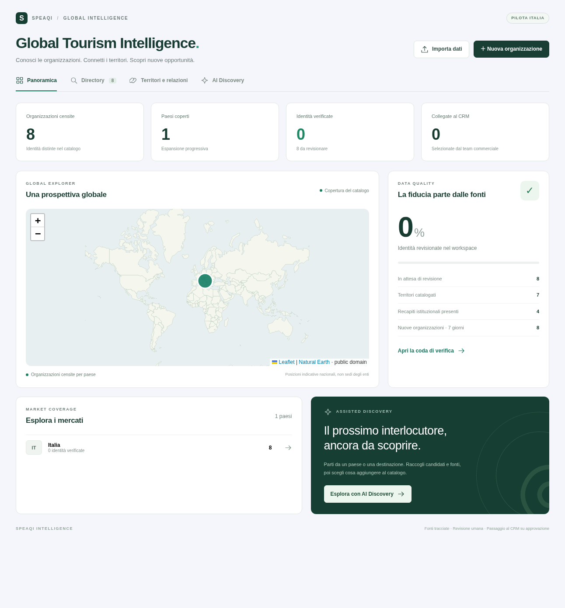

# Verifiche del 17 ottobre 2026

Ambiente locale: Node 24.19.0; il repository mantiene `engines.node=20.x`. Nessun database di produzione è stato modificato e nessuna email inviata. Il runtime Node 20 del deploy target va incluso nella validazione del rilascio.

| Verifica | Risultato e ambito |
| --- | --- |
| `npm run test:tourism` | 11 test unitari + 17 test database passati. Log: `test-results.txt` |
| Database | Migrazione eseguita in PGlite/PostgreSQL WASM con ruoli, RLS, trigger, funzioni e transazioni reali. Nessun mock per i vincoli SQL |
| Integrità | Import atomico, rollback anche dell'audit, reimport 17/17 senza modifiche, evidenze e identità verificate separate, modifiche che invalidano attestazioni, revisione su versione corrente |
| Sicurezza | Accesso area riservato al proprietario, RLS fra due workspace, inserimento cross-tenant negato, audit non scrivibile dall'utente, ingestione persone bloccata, schema relazioni tipizzato |
| CRM | Promozione idempotente, recapiti solo se verificati, nessun marketing eleggibile automatico, blocco per paese non normalizzato o email condivisa, niente duplicati silenziosi |
| Job | Esclusione di un secondo avvio durante una lease attiva; ripresa della lease scaduta con nuovo tentativo. La concorrenza multi-processo PostgreSQL/Supabase non è misurata da PGlite e richiede un test sul target |
| Ricerca | Nomi giapponesi conservati e ricercabili, pagine successive senza sovrapposizione, ricerca su più di una pagina |
| Performance locale | Ultimo run registrato: 600 fixture sintetiche importate in circa 460 ms; due pagine di ricerca in circa 3 ms. Include SQL in memoria, non rete o carico di produzione; non è uno SLA |
| Browser Chromium | 9 flussi passati con API intercettate: dashboard, categoria, ricerca, blocco CRM prima della verifica, revisione, promozione esplicita, import invalido, grafo, coda discovery senza provider; controllo viewport mobile e zero errori JS. Risultato in `browser-results.json` |
| Basemap | 177 feature Natural Earth servite localmente, caricate nel browser. La mappa non dipende da servizi di tile esterni. Provenienza/licenza in `public/tourism-assets/NOTICE.md` |
| Regressione mirata | Quattro file di test esistenti passati: scheduler, team login, fiere, email destinazioni. Log in `regression-results.txt`. La suite campagne su Postgres esterno non è stata eseguita in questo ambiente |
| TypeScript | `tsc --noEmit --incremental false` passato, inclusi i tipi delle route generati da Next |
| Build e packaging | Build Next riuscita, 138 pagine generate. Asset copiati nel bundle standalone dal nuovo hook postbuild; 177 feature della basemap servite con HTTP 200 dal server standalone |
| HTTP reale | `GET /api/tourism` senza bearer token ha risposto 401 con `Unauthorized` sul server locale |

La suite browser è passata anche sul bundle di produzione avviato mediante `start.cjs` (API sempre intercettate). La discovery è verificata con trasporto simulato: schema, fonti citate dal provider, limite di candidati e chiamate, esclusione di email personali/score inventati. Non è stata effettuata una ricerca AI reale: precisione del provider, latenza e costo per organizzazione verificata restano da misurare.

L'integrazione bidirezionale è implementata con transazioni SQL e conferma UI. Restano da provare sul Supabase del CRM: applicazione della migrazione nell'ordine corretto, promozione e sync end-to-end, backup e restore, revoca permessi e comportamento con più processi. Il campione italiano è una fixture documentata pronta all'importazione, non dati già pubblicati in produzione.

